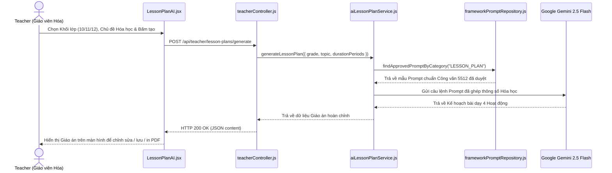
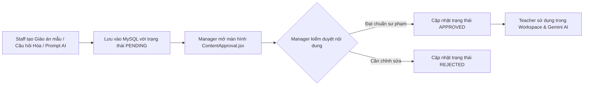

# 04. TÀI LIỆU THIẾT KẾ CHI TIẾT & SƠ ĐỒ UML 2.0 (DETAILED DESIGN DOCUMENT - DDD)
**Dự án:** PlanbookAI (PBA) – Cổng công cụ AI dành cho Giáo viên Hóa học THPT

## 1. Sơ đồ Tuần tự (Sequence Diagram - UML 2.0): Luồng Soạn Giáo Án Hóa Học Bằng Gemini AI

## 2. Sơ đồ Hoạt động (Activity Diagram - UML 2.0): Quy trình Kiểm duyệt Học liệu 3 Tác nhân

## 3. Thiết kế Chi tiết Kiến trúc 3 Lớp (Class Mapping)
- **Tầng Controller (`backend/src/controllers/`):** `authController`, `adminController`, `managerController`, `staffController`, `teacherController`.
- **Tầng Service (`backend/src/services/`):** `authService`, `adminService`, `managerService`, `staffService`, `aiLessonPlanService`, `questionExamService`, `ocrGradingService`.
- **Tầng Repository (`backend/src/repositories/`):** `userRepository`, `packageOrderRepository`, `frameworkPromptRepository`, `lessonPlanRepository`, `questionExamRepository`.